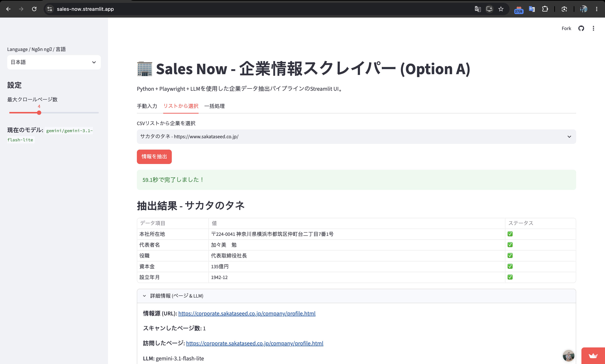
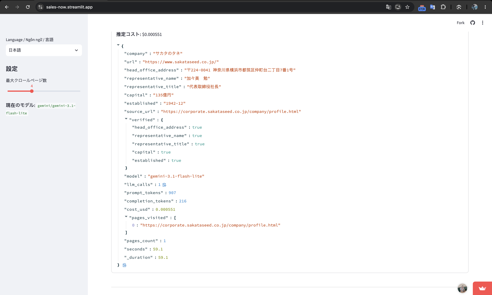
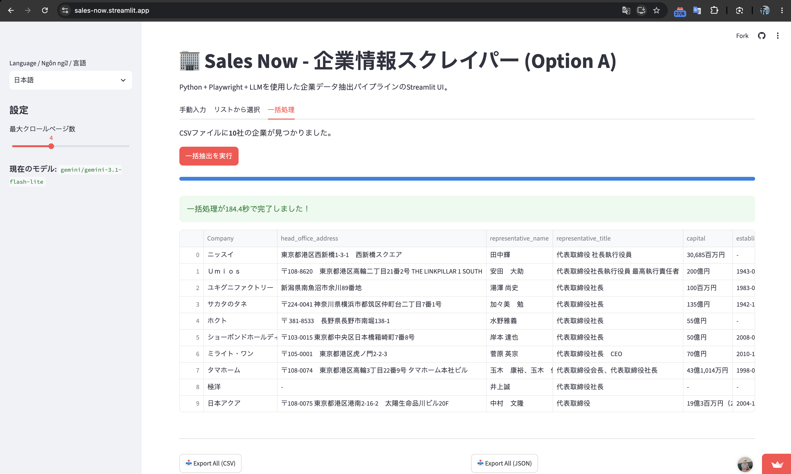
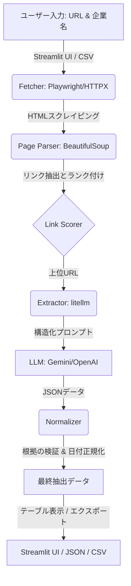

# 会社HPデータ取得ツール

**言語 / Language:** 日本語（本ファイル） | [English](README.en.md) | [Tiếng Việt](README.vi.md)

    

上場企業10社の公式サイトをリンクを辿ってクロールし、生成AI（LLM）で **本社住所・代表氏名・資本金・設立年月** を抽出します。サイトごとの個別セレクタは使わず、キーワードによるリンク順位付けで汎用的に処理します。

技術選定の比較は [docs/report.md](docs/report.md) を参照してください。

## 🚀 ライブデモ (Streamlit App)
🔗 **オンラインアクセス:** [https://sales-now.streamlit.app/](https://sales-now.streamlit.app/)





## 必要環境

- Python 3.9 以上
- いずれかのLLMのAPIキー（Gemini / OpenAI / Anthropic）、またはローカルの Ollama

## 環境構築

```bash
python3 -m venv .venv
source .venv/bin/activate          # Windows: .venv\Scripts\activate
pip install -r requirements.txt
playwright install chromium        # JSで描画されるサイト用のフォールバック
cp .env.example .env
```

`.env` を編集し、使うモデルとAPIキーを設定します。

```
LLM_MODEL=gemini/gemini-3.1-flash-lite
LLM_FALLBACK_MODEL=            # 任意。主モデルが失敗したときに使うモデル
GEMINI_API_KEY=xxxxxxxx
```

`LLM_MODEL` の例（litellm形式）: `gemini/gemini-3.1-flash-lite`、`gpt-4o-mini`（`OPENAI_API_KEY`）、`anthropic/claude-3-5-haiku-latest`（`ANTHROPIC_API_KEY`）、`ollama/llama3.1`（キー不要）。

> [!NOTE]
> モデルは提供終了になることがあります。`404` が出た場合は、各社のモデル一覧で現在利用可能なモデル名に変更してください。

## 実行方法

```bash
# 全10社（CLIで実行）
python src/main.py

# 1社だけ（社名の一部で絞り込み）
python src/main.py --only サカタ

# 探索ページ数を増やす（取得漏れがあるとき）
python src/main.py --max-pages 6
```

### Web UIでの実行（Streamlit - Option A）
日本語・英語・ベトナム語に対応したWebインターフェースで、各企業を対話的に抽出できます：
```bash
streamlit run src/app.py
```
自動的に `http://localhost:8501` でUIが開きます。


### テスト

```bash
python -m pytest -q tests
```

## 出力

| ファイル | 内容 |
|---|---|
| `result/companies.csv` | 抽出結果（Excel対応のUTF-8 BOM付き）とモデル・トークン・費用・秒数 |
| `result/companies.json` | 上記に加え、探索したURLと根拠の検証結果 |
| `result/run_log.json` | 実行全体のトークン数・費用・時間・実際に応答したモデル |

## 処理の流れ (Architecture & Flow)



1. トップページと、必要に応じて下位ページからリンクを収集（同一ドメインのサブドメインも対象）。
2. 「会社概要」「企業情報」「corporate」「profile」等のキーワードでリンクを順位付け。
3. 上位ページの本文を整形し、LLMにJSON形式で抽出させる（情報がなければ `null`、推測しない）。
4. 引用された根拠が本文に実在するかを確認し、設立年月を `YYYY-MM` に正規化。
5. 欠損項目があれば、次の候補ページで補完。

## ディレクトリ構成

```
├── input/companies.csv   # 対象企業リスト
├── prompts/              # 生成AIに使用したプロンプトの履歴
├── result/               # 取得したデータ
├── src/                  # ソースコード
├── tests/                # 単体テスト
├── README.md
└── report.md
```

## 既知の制約

- Gemini の無料枠はレート制限（例: 15リクエスト/分）があり、`429` で一部の項目が欠損することがあります。その場合は `--only` で該当企業のみ再実行してください。
- 資本金は原文のまま保持します（例: `30,685百万円`）。数値への統一は行っていません。
- 取得値の正誤は、公式サイトとの照合を別途行ってください（[report.md](report.md) の付録A）。
- `.env` はコミットしないでください（`.gitignore` 済み）。
