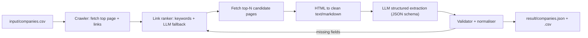

# Implementation Plan: Web Scraping & Data Extraction Assignment

## 1. Goal and Constraints

| Item | Detail |
|---|---|
| Deadline | 9 hours from start; graded on the commit at that time |
| Task A (required) | 10 listed companies → HQ address, representative name, capital, founding year/month |
| Task B (bonus) | `vn.indeed.com/jobs?q=remote` → report on anti-bot measures + approaches tried |
| Tech comparison | Cost / Speed / Quality, written in `report.md` |
| Language | `README.md` must be in **Japanese**; `report.md` language is not specified (recommend Japanese, optionally with English) |
| AI usage | Allowed, but chat prompts/responses must be saved in `prompts/` |
| Delivery | Private GitHub repo; invite `atsunori0406`, `salesnow-tomohiro` (the brief says "3 people" but lists 2, so confirm this) |

> [!IMPORTANT]
> Commit early and often. Grading uses the commit at the deadline, and partial progress is scored.

## 2. Time Budget (9h)

| Phase | Time | Output |
|---|---|---|
| 0. Setup: repo, venv, API key, save prompts habit | 0:30 | Repo skeleton, first commit |
| 1. Recon: inspect the 10 sites manually, find where company info lives | 0:45 | Notes on URL patterns (`/company/`, `/corporate/outline`, `/ir/`) |
| 2. Build Task A pipeline (fetch → find page → extract) | 2:30 | Working scraper on 3 sites |
| 3. Run all 10, fix failures, validate vs. ground truth | 1:30 | `result/*.csv/json` at 10/10 |
| 4. Tech comparison experiments (small benchmark) | 1:00 | Real numbers for the report |
| 5. Task B investigation | 1:15 | Evidence + findings |
| 6. `README.md`, `report.md`, tidy prompts | 1:00 | Docs |
| Buffer / final check / push | 0:30 | Final commit |

Hard checkpoints: commit at the end of each phase. By hour 6, Task A must be done and pushed before starting Task B.

## 3. Technology Selection (Evaluation)

### 3.1 Candidates

| Option | Cost | Speed (dev / run) | Quality / Completeness | Verdict |
|---|---|---|---|---|
| **A. Python + Playwright/httpx + BeautifulSoup + LLM (OpenAI/Gemini/Claude) with structured output** | Low: free libraries, LLM about ¥1–5 for the run | Dev: medium. Run: fast with a light-HTML-first strategy | High: full control, handles JS pages and retries, easy to debug | **Recommended** |
| B. TypeScript + Firecrawl + Vercel AI SDK | Medium: Firecrawl credits (free tier is limited) | Dev: fast. Run: fast | High for markdown conversion, but depends on an external service and crawl limits | Good alternative; benchmark it |
| C. Dify / n8n (no-code) | Low to medium: hosting/self-host setup | Dev: fast for prototypes. Run: slow, and the loop/crawl logic is clumsy | Medium: hard to build generic link-following, hard to test | Not suited to "high generality" |
| D. Pure regex/CSS selectors per site | Lowest runtime cost | Dev: slow (10 hand-written parsers). Run: fastest | Low generality: breaks on new sites, which fails the requirement | Rejected as the main approach; fine as a validator |
| E. LLM-agent browsing (Browser-use, Playwright MCP) | Highest: many LLM calls | Slow and unpredictable | Flexible but non-deterministic | Use only as a fallback for hard sites |

### 3.2 Decision

Choose **Option A, a hybrid pipeline**: deterministic crawling and page ranking, with LLM extraction only on the few relevant pages. This keeps cost low, keeps quality high, and stays generic because there are no per-site selectors.

Evidence to collect for `report.md` (run on 3 sites minimum):
- Dev time estimate per option
- Tokens and cost per company
- Seconds per company
- Accuracy of the 4 fields vs. ground truth (field-level, 40 values total)

## 4. Task A: Architecture



### 4.1 Steps

1. **Input**: `input/companies.csv` (name, url).
2. **Fetch**: try `httpx` first (fast). If the body is empty or JS-rendered, fall back to **Playwright**. Set a User-Agent, timeout, retries with backoff, and a polite delay. Check `robots.txt`.
3. **Link discovery**: extract `<a>` from the top page, the footer, and the sitemap (`/sitemap.xml`).
4. **Link ranking (generic, language-aware)**:
   - Score anchor text and URLs using JP keywords: `会社概要`, `企業情報`, `会社情報`, `企業概要`, `corporate`, `company`, `about`, `outline`, `profile`, `overview`, `ir`.
   - Take the top 3–5 candidates and follow them up to depth 2 (for example, 企業情報 → 会社概要).
   - Fallback: ask the LLM to pick the best links from the list of (text, URL) pairs.
5. **Cleaning**: strip nav/script/style, convert to markdown or plain text, and truncate to the token budget. Prefer `<table>` and `<dl>` content, since company outlines usually live there.
6. **Extraction**: LLM with a strict JSON schema:
   ```json
   {
     "company_name": "str",
     "head_office_address": "str|null",
     "representative_name": "str|null",
     "representative_title": "str|null",
     "capital": "str|null",
     "established": "YYYY-MM|null",
     "source_url": "str",
     "evidence": {"field": "quoted source snippet"}
   }
   ```
   The prompt says "return null instead of guessing" and "keep the original text for the evidence field".
7. **Validation and normalisation**:
   - `established` → `YYYY-MM` (convert 和暦 such as 昭和24年 → 1949; use `jaconv`/regex).
   - Address must contain 都/道/府/県. Capital must contain 円 and a number.
   - If a field is null, crawl the next candidate page (loop up to N times).
   - Check that the evidence snippet actually appears in the page text, to catch hallucination.
8. **Output**: `result/companies.json` and `result/companies.csv` (UTF-8 with BOM for Excel), plus `result/run_log.json` (pages visited, tokens, time).

### 4.2 Site-specific risks

| Company | Likely risk | Mitigation |
|---|---|---|
| ニッスイ, 極洋 | Large corporate site; the outline is deep in the menu | Depth-2 crawl + sitemap |
| Umios (merged group) | Name/representative may differ from the old brand | Check the title and company name |
| ユキグニファクトリー, ホクト | Brand pages show the product site, not the corporate site | Look for a 企業情報 link |
| サカタのタネ | Capital may appear as "xx百万円" | Normalisation |
| ショーボンドHD, ミライト・ワン | Holding companies, so there may be multiple entities | Take the head entity's details only |
| タマホーム, 日本アクア | JS-heavy or dynamic menus | Playwright fallback |

### 4.3 Quality assurance

- Build a **ground-truth table** by manually checking all 10 companies (40 values) once, using each site's 会社概要 page. Do not use the LLM for this.
- Report field-level accuracy and a confusion list in `report.md`.
- Run 2–3 times to check determinism (temperature 0).

## 5. Task B: Indeed (vn.indeed.com) Investigation

Treat this as an **experiment log**. The goal is a well-documented investigation, not necessarily success.

### 5.1 Experiments (in order)

| # | Approach | What to observe |
|---|---|---|
| 1 | Plain `requests`/`httpx` | Status code (likely 403), the response body (Cloudflare challenge?), headers like `cf-ray`, `server: cloudflare` |
| 2 | Add realistic headers (UA, Accept-Language, Referer) | Whether the 403 changes |
| 3 | Playwright headless | Does the challenge page appear? Check `navigator.webdriver` |
| 4 | Playwright headed + `playwright-stealth` / `undetected-chromedriver` / `patchright` / `camoufox` | Does it pass the JS challenge, or does it hit a CAPTCHA (Turnstile)? |
| 5 | Use the real Chrome profile via CDP (`--remote-debugging-port`) | Usually passes basic checks; note reproducibility |
| 6 | Look for an alternative: official publisher API, RSS, sitemap, `job` JSON in `__NEXT_DATA__`/`mosaic-data` | Whether data is available in a legitimate way |
| 7 | Residential proxy / Web Unlocker (only analysis of cost, not purchase, unless free trial) | Document cost vs. benefit |

### 5.2 Report content (`report.md` section B)

- Observed anti-bot measures: Cloudflare bot management, TLS/JA3 fingerprinting, JS challenge, Turnstile CAPTCHA, IP reputation/rate limiting, headless detection, behaviour analysis.
- Each approach: what was tried, the result (status, screenshot, headers), and the interpretation.
- Conclusion: what worked or did not, and the recommended production approach (for example: official API/partnership, a data vendor, or a managed unblocker).
- **Ethics and legality note**: check Indeed's Terms of Service and `robots.txt`; do not log in, do not bypass CAPTCHAs on a large scale, and keep the request volume tiny (a few requests). Say this explicitly in the report. It shows good judgement.

## 6. Repository Layout

```
.
├── input/companies.csv
├── prompts/              # AI chat logs (txt): 01_planning.txt, 02_extractor_prompt.txt, ...
├── result/               # companies.json, companies.csv, run_log.json
├── src/
│   ├── main.py           # CLI entry point
│   ├── fetcher.py        # httpx + Playwright fallback
│   ├── link_ranker.py
│   ├── cleaner.py
│   ├── extractor.py      # LLM call + schema
│   ├── normalizer.py     # date/capital/address validation
│   └── indeed_probe.py   # Task B experiments
├── tests/                # Normaliser unit tests
├── README.md             # Japanese: setup, run, env vars
├── report.md             # Tech comparison + Task B analysis
├── requirements.txt
├── .env.example
└── .gitignore            # .env, .venv, caches
```

> [!WARNING]
> Never commit API keys. Use `.env` and commit only `.env.example`.

## 7. Deliverable Checklists

**README.md (Japanese)**: overview, prerequisites (Python version), setup (`python -m venv`, `pip install`, `playwright install chromium`), env vars, run command (`python src/main.py --input input/companies.csv`), output description, directory structure, known limitations.

**report.md**: (1) summary, (2) options compared in a table with the three axes and real numbers, (3) selection reasoning, (4) Task A results and accuracy, (5) failures and lessons, (6) Task B findings, (7) next steps (how to scale to thousands of companies).

**prompts/**: export every chat (including this planning chat) to `.txt`, with the shared link as a backup.

## 8. Evaluation Self-Check (matches the grading criteria)

| Criterion | How this plan satisfies it |
|---|---|
| Understanding | Reads the task precisely: generic crawling (not per-site hacks), Japanese README, 3-axis comparison |
| Design | Hybrid pipeline justified with measured cost/speed/quality |
| AI usage | LLM used for extraction and ranking fallback only, with schema, evidence, and validation; all prompts saved |
| Documentation | Clear README (JA), report with tables and numbers, tidy repo |

## 9. Risks and Mitigations

| Risk | Impact | Mitigation |
|---|---|---|
| LLM hallucination | Wrong data | Evidence quote check, null-over-guess, ground-truth comparison |
| JS-rendered sites | Empty content | Playwright fallback |
| Wrong page chosen (e.g. IR page) | Wrong values | Rank by keyword score and loop to the next candidate if fields are missing |
| Running out of time | Incomplete delivery | Phase checkpoints, early commits, Task B only after A is done |
| Indeed blocks everything | No data | Success is not required; document the evidence |
| API cost/rate limits | Delays | Pre-filter the text and cache fetched pages in `.cache/` |

## 10. Open Questions

1. Which LLM provider/API key should I use (OpenAI, Gemini, Anthropic)?
2. Should `report.md` be in Japanese, English, or both?
3. Is the submission 2 or 3 GitHub collaborators (the brief lists 2)?
4. Confirm the start time, so we can set the 9-hour deadline.
