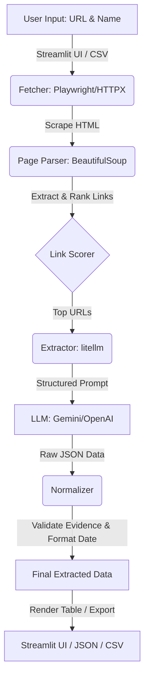

# report — Technology Comparison & Task B Findings

**Language:** [日本語](report.md) | English (this file) | [Tiếng Việt](report.vi.md)

> Figures come from `result/run_log.json`, `result/companies.json` and `result/indeed_probe.json`. Anything marked "estimate" was NOT measured.

## 1. Architecture

## 1.1 Summary

| Item | Result |
|---|---|
| Chosen stack | Python + httpx / Playwright + BeautifulSoup + LLM (via litellm, Gemini) |
| Task A | At least one field for all 10 companies; **35 of 40 fields filled (87.5%)**; 5 missing |
| Task A cost | **~0.0088 USD** total (17 LLM calls; 17,120 input / 2,985 output tokens) |
| Task A time | **150.1 s** total (mostly retries on one company; see below) |
| Task B | Default-UA httpx got **403**. httpx with browser-like headers and Playwright both retrieved the page (within this limited test) |

> [!NOTE]
> **Correctness has not been verified against the official sites yet.** Fill rate is not accuracy. See Appendix A.

## 2. Technology Comparison

Axes required by the assignment: Cost, Speed, Quality/Completeness.

| Approach | Cost | Speed | Quality / Completeness | Verdict |
|---|---|---|---|---|
| **A. Python + Playwright/httpx + BS4 + LLM (chosen)** | Low. Free libs; measured ~0.0009 USD per company | Medium dev time; fast runs (~2.4–3.4 s when one page suffices) | General and controllable; link-ranking rules need tuning | ◎ |
| B. TypeScript + Firecrawl + Vercel AI SDK | Medium: credit-based (estimate) | Fast to build (estimate) | Good markdown, but external dependency | ○ not tested |
| C. Dify / n8n (no-code) | Low–medium; hosting needed (estimate) | Fast prototype; crawl loops are clumsy (estimate) | Hard to be generic across sites | △ not tested |
| D. Per-site selectors/regex only | Lowest run cost | Fastest run; slow to build 10 parsers | Brittle; **violates the "high generality" requirement** | × |
| E. LLM browsing agents | High: many calls (estimate) | Slow, unstable (estimate) | Flexible but non-deterministic | △ fallback only |

> [!IMPORTANT]
> Only approach A was actually built and measured. B–E are estimates from general knowledge, not benchmarks.

### Why A

1. **Cost:** one LLM call per page is usually enough; all 10 companies cost 0.0088 USD.
2. **Speed:** crawling is rule-based and the LLM only reads candidate pages, so only 17 calls were needed.
3. **Quality:** the prompt forbids guessing (null instead), and each quoted evidence snippet is checked against the page text to limit hallucination.
4. **Generality:** no per-site selectors; one keyword-based link ranking (会社概要, 企業情報, corporate, profile, …) handles every site.

## 3. Task A Results

Pipeline: `fetcher.py` (httpx → Playwright fallback) → `page_parser.py` (link ranking, text cleaning) → `extractor.py` (LLM structured extraction) → `normalizer.py` (validation/normalisation).

### Results (`result/companies.csv`)

| Company | Address | Representative | Capital | Established | LLM calls | Seconds |
|---|---|---|---|---|---|---|
| Nissui | ✓ | ✓ | ✓ | **missing** | 4 | 105.7 |
| Umios | ✓ | ✓ | ✓ | ✓ | 1 | 3.2 |
| Yukiguni Factory | ✓ | ✓ | ✓ | ✓ | 1 | 2.5 |
| Sakata Seed | ✓ | ✓ | ✓ | ✓ | 1 | 2.5 |
| Hokto | ✓ | ✓ | ✓ | **missing** | 4 | 13.9 |
| Sho-Bond Holdings | ✓ | ✓ | ✓ | ✓ | 1 | 2.4 |
| Mirait One | ✓ | ✓ | ✓ | ✓ | 1 | 2.4 |
| Tama Home | ✓ | ✓ (2 names listed) | ✓ | ✓ | 1 | 3.4 |
| Kyokuyo | **missing** | ✓ | **missing** | **missing** | 2 | 11.3 |
| Nippon Aqua | ✓ | ✓ | ✓ | ✓ | 1 | 2.8 |

Fill rate: 35 of 40 fields (87.5%). **This is how many values were retrieved, not how many are correct.**

### Known issues

| Issue | Cause | Proposed fix |
|---|---|---|
| Kyokuyo: address, capital, established missing | **HTTP 429 (Gemini free tier: 15 requests/min)** made the LLM calls fail (seen in logs) | Add request throttling; re-run Kyokuyo |
| Nissui, Hokto: established missing | Within 4 pages, none gave a usable value, or extraction failed (**cause not yet identified**) | Raise page limit; prioritise history pages (needs testing) |
| Nissui took 105.7 s | Primary model `gemini-3.8-flash` timed out (60 s) on each call, then fell back | Use `gemini-3.1-flash-lite` as primary |
| Capital formats vary (`30,685百万円`, `19億3百万円（2025年12月31日現在）`) | Raw text is kept by design | Add numeric normalisation (JPY) |
| Tama Home shows two representatives | Page lists co-representatives | Likely correct; verify |

> [!WARNING]
> The `model` field in `run_log.json` shows the configured primary model. The model that actually answered is in `usage.models_used` (all 17 calls: `gemini-3.1-flash-lite`).

## 4. Task B Results (Indeed)

Target: `https://vn.indeed.com/jobs?q=remote`. **One request per approach**, same IP and time window; run twice with identical results.

| # | Approach | Result |
|---|---|---|
| 1 | httpx, default User-Agent | **403 Blocked**; `server: cloudflare`, `cf-ray`, `__cf_bm` cookie seen; 0 jobs |
| 2 | httpx + browser-like headers (UA, Accept-Language, Referer) | **200**, 32 job cards |
| 3 | Playwright headless | **200**, 32 cards, even with `navigator.webdriver = true` |
| 4 | Playwright headed | **200**, 32 cards |

### Confirmed anti-bot measures

- **Cloudflare** is in front of the site (response header `server: cloudflare`, `cf-ray`, `__cf_bm`/`_cfuvid` cookies).
- **Header/User-Agent screening:** default httpx was rejected at once; browser-like headers got through. This is an observation; the internal logic is unknown.

### Not observed / not determined

- No CAPTCHA (Turnstile) or JS challenge appeared this time.
- TLS fingerprinting, behavioural analysis and IP reputation could not be confirmed or ruled out.
- Only a handful of requests were made; high-volume behaviour was **not tested**.

### Discussion

- Results may vary by IP, time and volume, so reproducibility is not guaranteed.
- For sustained production use, prefer an official API/partnership or a data vendor.
- **Ethics/terms:** check the site's terms and `robots.txt`. This test used no login, no CAPTCHA bypass and only a few requests.

## 5. Generative AI Usage

- Runtime: Gemini via litellm (switch with `LLM_MODEL`; OpenAI/Anthropic/Ollama also work).
- Development: chat AI was used; prompt/response history goes in `prompts/`.

## 6. Next Steps

1. Throttle requests; re-run Kyokuyo, Nissui, Hokto.
2. Verify against official sites to compute accuracy (Appendix A).
3. Extend capital/date normalisation.
4. At thousands of companies: async I/O, caching, controlled concurrency.

## Appendix A — Ground-truth check (TODO)

Fill in after manually checking each official site.

| Company | Address | Representative | Capital | Established |
|---|---|---|---|---|
| Nissui | | | | |
| Umios | | | | |
| Yukiguni Factory | | | | |
| Sakata Seed | | | | |
| Hokto | | | | |
| Sho-Bond Holdings | | | | |
| Mirait One | | | | |
| Tama Home | | | | |
| Kyokuyo | | | | |
| Nippon Aqua | | | | |
