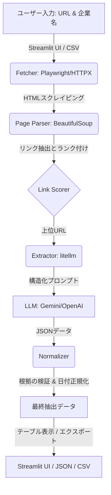

# report.md — 技術選定の比較と課題Bの考察

**言語 / Language:** 日本語（本ファイル） | [English](report.en.md) | [Tiếng Việt](report.vi.md)

> 数値は `result/run_log.json`・`result/companies.json`・`result/indeed_probe.json` の実測値です。「推定」と書いた箇所は実測していません。

## 1. アーキテクチャ (Architecture & Flow)

## 1.1 サマリー

| 項目 | 結果 |
|---|---|
| 採用技術 | Python + httpx / Playwright + BeautifulSoup + LLM（litellm 経由、Gemini） |
| 課題A | 10社すべてで少なくとも1項目を取得。40項目中 **35項目を取得（87.5%）**、5項目が欠損 |
| 課題A のコスト | 合計 **約 0.0088 USD**（17回のLLM呼び出し、入力 17,120 / 出力 2,985 トークン） |
| 課題A の実行時間 | 合計 **150.1 秒**（大半は特定企業での再試行。下記参照） |
| 課題B | 既定UAの httpx は **403 でブロック**。ブラウザ相当ヘッダ付き httpx と Playwright は取得可能（本検証の範囲では） |

> [!NOTE]
> 取得した値の**正誤は、公式サイトとの照合を人手で行うまで確定していません**。「取得率」と「正解率」は別物です。付録A の照合表で確認してください。

## 2. 技術選定の比較

評価軸は課題指定の3点（コスト・スピード・品質/網羅性）です。

| 手法 | コスト | スピード | 品質・網羅性 | 評価 |
|---|---|---|---|---|
| **A. Python + Playwright/httpx + BS4 + LLM（採用）** | 低。ライブラリは無料、LLMは実測 約0.0009 USD/社 | 開発は中程度。実行は軽量HTML優先で高速（1ページで済む社は約2.4〜3.4秒） | 汎用性が高く、制御しやすい。ただしリンク選別ルールの調整が必要 | ◎ |
| B. TypeScript + Firecrawl + Vercel AI SDK | 中。Firecrawl のクレジット課金（推定） | 開発は速い（推定） | Markdown変換は良好だが外部サービス依存 | ○ 未検証 |
| C. Dify / n8n（ノーコード） | 低〜中。ホスティングの用意が必要（推定） | プロトタイプは速いが、リンク探索ループの構築が煩雑（推定） | 「サイトごとの差異への汎用対応」を実装しにくい | △ 未検証 |
| D. サイト別のCSSセレクタ/正規表現のみ | 実行コスト最小 | 実行は最速だが、10社分の個別実装で開発が遅い | 新規サイトに弱く、**課題の「高い汎用性」要件を満たさない** | × |
| E. LLMエージェントによるブラウザ操作 | 高（呼び出し回数が多い）（推定） | 遅く、実行時間が不安定（推定） | 柔軟だが再現性が低い | △ 補助用途 |

> [!IMPORTANT]
> B・C・D・E は**今回実際には動かして計測していません**。上表の「推定」は一般的な知識に基づく見立てであり、実測値ではありません。実測したのは A のみです。

### 選定理由

1. **コスト**: 1ページにつき1回のLLM呼び出しで足りる社が多く、全10社で 0.0088 USD に収まった。
2. **スピード**: クロール（リンク順位付け）は決定的なルールで行い、LLMは候補ページの抽出だけに使うため、呼び出し回数を抑えられた（10社で17回）。
3. **品質**: LLMに「推測せず null を返す」ことを指示し、引用した根拠が実際のページ本文に含まれるかを機械的に確認して、ハルシネーションを抑えている。
4. **汎用性**: サイト別セレクタを使わず、キーワード（会社概要、企業情報、corporate、profile 等）によるリンク順位付けで全社を同一ロジックで処理。

## 3. 課題A 結果

構成: `fetcher.py`（httpx→Playwright フォールバック）→ `page_parser.py`（リンク順位付け・本文整形）→ `extractor.py`（LLM構造化抽出）→ `normalizer.py`（検証・正規化）。

### 取得結果（`result/companies.csv`）

| 企業 | 住所 | 代表者 | 資本金 | 設立 | LLM回数 | 秒 |
|---|---|---|---|---|---|---|
| ニッスイ | ○ | ○ | ○ | **欠損** | 4 | 105.7 |
| Umios | ○ | ○ | ○ | ○ | 1 | 3.2 |
| ユキグニファクトリー | ○ | ○ | ○ | ○ | 1 | 2.5 |
| サカタのタネ | ○ | ○ | ○ | ○ | 1 | 2.5 |
| ホクト | ○ | ○ | ○ | **欠損** | 4 | 13.9 |
| ショーボンドHD | ○ | ○ | ○ | ○ | 1 | 2.4 |
| ミライト・ワン | ○ | ○ | ○ | ○ | 1 | 2.4 |
| タマホーム | ○ | ○（2名併記） | ○ | ○ | 1 | 3.4 |
| 極洋 | **欠損** | ○ | **欠損** | **欠損** | 2 | 11.3 |
| 日本アクア | ○ | ○ | ○ | ○ | 1 | 2.8 |

取得率: 40項目中35項目（87.5%）。**これは取得できた割合であり、正解率ではありません。**

### 既知の問題と原因

| 問題 | 原因 | 対応案 |
|---|---|---|
| 極洋の住所・資本金・設立が欠損 | **429（Gemini無料枠: 15リクエスト/分）に到達**し、LLM呼び出しが失敗したため（ログで確認） | リクエスト間隔の制御を追加し、極洋のみ再実行 |
| ニッスイ・ホクトの設立年月が欠損 | 最大4ページ探索しても設立年月を含むページに到達できなかった、または抽出が失敗（**原因は未特定**） | 探索ページ数の増加、沿革ページの優先度調整（要検証） |
| ニッスイが 105.7 秒 | 主モデル `gemini-3.8-flash` が毎回タイムアウト（60秒）し、フォールバックモデルに切替えたため | 主モデルを `gemini-3.1-flash-lite` に変更 |
| 資本金の表記ゆれ（`30,685百万円`、`19億3百万円（2025年12月31日現在）`） | 原文のまま保持する仕様 | 数値化（円単位）の正規化を追加 |
| タマホームの代表者が2名併記 | ページ上に共同代表として記載 | 仕様どおり。要確認 |

> [!WARNING]
> `result/run_log.json` の `model` フィールドは、設定上の主モデルを表示します。実際に応答したモデルは `usage.models_used`（全17回が `gemini-3.1-flash-lite`）を参照してください。

## 4. 課題B（Indeed）結果

対象: `https://vn.indeed.com/jobs?q=remote`。**各手法につき1リクエストのみ**、同一IP・同一時間帯での検証（計2回実行、同じ結果）。

| # | 手法 | 結果 |
|---|---|---|
| 1 | httpx（既定User-Agent） | **403 Blocked**。`server: cloudflare`、`cf-ray`、`__cf_bm` Cookie を確認。ジョブ 0件 |
| 2 | httpx + ブラウザ相当ヘッダ（UA, Accept-Language, Referer） | **200**、ジョブカード 32件 |
| 3 | Playwright headless | **200**、32件。`navigator.webdriver = true` のままでも取得 |
| 4 | Playwright headed | **200**、32件 |

### 確認できたBot対策

- **Cloudflare**（レスポンスヘッダ `server: cloudflare`、`cf-ray`、`__cf_bm`/`_cfuvid` Cookie から確認）。
- **ヘッダ/User-Agent による判別**: 既定の httpx は即座に 403。ヘッダを整えると通過した。これは観測事実であり、内部の判定ロジックは不明。

### 確認できなかったこと

- CAPTCHA（Turnstile）やJSチャレンジは**今回は表示されなかった**。
- TLSフィンガープリント、行動分析、IPレピュテーションが使われているかは**今回の実験では判別できていない**。
- 本検証は少量リクエストのみ。大量アクセス時の挙動は**未検証**。

### 考察

- 結果は IP・時間帯・アクセス量で変わりうるため、再現性は保証できない。
- 本番で継続的にデータが必要な場合は、公式API/提携、データ提供ベンダー等の正規ルートを検討すべき。
- **倫理・規約**: 利用規約と `robots.txt` の確認が必要。本検証はログインなし・CAPTCHA回避なし・数リクエストのみで実施した。

## 5. 生成AIの利用

- 実行時: litellm 経由で Gemini を使用（`.env` の `LLM_MODEL` で変更可能。OpenAI / Anthropic / Ollama にも切替可）。
- 開発時: チャット型の生成AIを使用。プロンプトと回答の履歴は `prompts/` に格納する。

## 6. 今後の改善

1. リクエスト間隔の制御（レート制限対策）と 極洋・ニッスイ・ホクト の再実行。
2. 公式サイトとの照合による正解率の算出（付録A）。
3. 資本金・日付の正規化の拡充。
4. 数千社規模への拡張時は、非同期化・結果キャッシュ・並列度の制御が必要。

## 付録A 照合表（要記入）

公式サイトで人手確認し、正誤を記入してください。

| 企業 | 住所 | 代表者 | 資本金 | 設立 |
|---|---|---|---|---|
| ニッスイ | | | | |
| Umios | | | | |
| ユキグニファクトリー | | | | |
| サカタのタネ | | | | |
| ホクト | | | | |
| ショーボンドHD | | | | |
| ミライト・ワン | | | | |
| タマホーム | | | | |
| 極洋 | | | | |
| 日本アクア | | | | |
