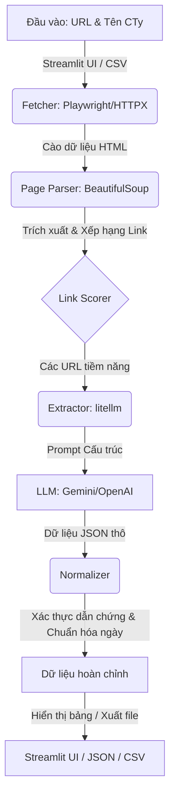

# report — So sánh công nghệ & kết quả Bài B

**Ngôn ngữ:** [日本語](report.md) | [English](report.en.md) | Tiếng Việt (file này)

> Số liệu lấy từ `result/run_log.json`, `result/companies.json` và `result/indeed_probe.json`. Chỗ ghi "ước tính" là **chưa đo thực tế**.

## 1. Kiến trúc (Architecture)

## 1.1 Tóm tắt

| Mục | Kết quả |
|---|---|
| Công nghệ chọn | Python + httpx / Playwright + BeautifulSoup + LLM (qua litellm, Gemini) |
| Bài A | Cả 10 công ty đều lấy được ít nhất 1 trường; **35/40 trường (87,5%)**, thiếu 5 trường |
| Chi phí Bài A | **~0,0088 USD** tổng (17 lần gọi LLM; 17.120 token vào / 2.985 token ra) |
| Thời gian Bài A | **150,1 giây** tổng (chủ yếu do thử lại ở một công ty; xem bên dưới) |
| Bài B | httpx với User-Agent mặc định bị **403**. httpx có header giống trình duyệt và Playwright đều lấy được trang (trong phạm vi kiểm thử nhỏ này) |

> [!NOTE]
> **Chưa kiểm tra độ đúng so với trang chính thức.** Tỉ lệ lấy được không phải là độ chính xác. Xem Phụ lục A.

## 2. So sánh công nghệ

Ba tiêu chí theo đề bài: Chi phí, Tốc độ, Chất lượng/Độ toàn diện.

| Phương án | Chi phí | Tốc độ | Chất lượng / Độ toàn diện | Đánh giá |
|---|---|---|---|---|
| **A. Python + Playwright/httpx + BS4 + LLM (đã chọn)** | Thấp. Thư viện miễn phí; đo được ~0,0009 USD/công ty | Phát triển trung bình; chạy nhanh (~2,4–3,4 giây khi 1 trang là đủ) | Linh hoạt, dễ kiểm soát; cần chỉnh quy tắc chọn link | ◎ |
| B. TypeScript + Firecrawl + Vercel AI SDK | Trung bình: tính theo credit (ước tính) | Dựng nhanh (ước tính) | Markdown tốt nhưng phụ thuộc dịch vụ ngoài | ○ chưa thử |
| C. Dify / n8n (no-code) | Thấp–trung bình; cần chỗ host (ước tính) | Prototype nhanh; vòng lặp crawl khó làm (ước tính) | Khó tổng quát hóa cho nhiều site | △ chưa thử |
| D. Chỉ dùng selector/regex riêng từng site | Chi phí chạy thấp nhất | Chạy nhanh nhất; viết 10 parser rất chậm | Dễ vỡ; **không đáp ứng yêu cầu "tính linh hoạt cao"** | × |
| E. Agent LLM điều khiển trình duyệt | Cao: nhiều lần gọi (ước tính) | Chậm, không ổn định (ước tính) | Linh hoạt nhưng không tái lập được | △ chỉ dự phòng |

> [!IMPORTANT]
> Chỉ phương án A được xây dựng và đo thực tế. B–E chỉ là ước tính dựa trên hiểu biết chung, **không phải số đo**.

### Lý do chọn A

1. **Chi phí:** thường 1 lần gọi LLM cho mỗi trang là đủ; cả 10 công ty tốn 0,0088 USD.
2. **Tốc độ:** việc crawl dùng quy tắc cố định, LLM chỉ đọc các trang ứng viên nên chỉ cần 17 lần gọi.
3. **Chất lượng:** prompt cấm đoán mò (trả `null`), và đoạn trích dẫn làm bằng chứng được kiểm tra có thật trong nội dung trang để hạn chế ảo giác.
4. **Tính tổng quát:** không dùng selector riêng từng site; một cách xếp hạng link theo từ khóa (会社概要, 企業情報, corporate, profile, …) xử lý mọi site.

## 3. Kết quả Bài A

Pipeline: `fetcher.py` (httpx → dự phòng Playwright) → `page_parser.py` (xếp hạng link, làm sạch văn bản) → `extractor.py` (LLM trích xuất có cấu trúc) → `normalizer.py` (kiểm tra/chuẩn hóa).

### Kết quả (`result/companies.csv`)

| Công ty | Địa chỉ | Người đại diện | Vốn điều lệ | Thành lập | Số lần gọi LLM | Giây |
|---|---|---|---|---|---|---|
| Nissui | ✓ | ✓ | ✓ | **thiếu** | 4 | 105,7 |
| Umios | ✓ | ✓ | ✓ | ✓ | 1 | 3,2 |
| Yukiguni Factory | ✓ | ✓ | ✓ | ✓ | 1 | 2,5 |
| Sakata Seed | ✓ | ✓ | ✓ | ✓ | 1 | 2,5 |
| Hokto | ✓ | ✓ | ✓ | **thiếu** | 4 | 13,9 |
| Sho-Bond Holdings | ✓ | ✓ | ✓ | ✓ | 1 | 2,4 |
| Mirait One | ✓ | ✓ | ✓ | ✓ | 1 | 2,4 |
| Tama Home | ✓ | ✓ (ghi 2 người) | ✓ | ✓ | 1 | 3,4 |
| Kyokuyo | **thiếu** | ✓ | **thiếu** | **thiếu** | 2 | 11,3 |
| Nippon Aqua | ✓ | ✓ | ✓ | ✓ | 1 | 2,8 |

Tỉ lệ lấy được: 35/40 trường (87,5%). **Đây là số giá trị lấy được, không phải số giá trị đúng.**

### Vấn đề đã biết

| Vấn đề | Nguyên nhân | Hướng xử lý |
|---|---|---|
| Kyokuyo thiếu địa chỉ, vốn, năm thành lập | **HTTP 429 (Gemini bản miễn phí: 15 request/phút)** làm các lần gọi LLM thất bại (thấy trong log) | Thêm giãn cách request; chạy lại Kyokuyo |
| Nissui, Hokto thiếu năm thành lập | Trong 4 trang không có trang nào cho giá trị dùng được, hoặc trích xuất lỗi (**chưa xác định nguyên nhân**) | Tăng số trang; ưu tiên trang lịch sử (cần thử) |
| Nissui mất 105,7 giây | Model chính `gemini-3.8-flash` bị timeout (60 giây) mỗi lần gọi rồi mới chuyển sang model dự phòng | Dùng `gemini-3.1-flash-lite` làm model chính |
| Định dạng vốn điều lệ không đồng nhất (`30,685百万円`, `19億3百万円（2025年12月31日現在）`) | Cố ý giữ nguyên văn | Thêm chuẩn hóa thành số (đơn vị yên) |
| Tama Home ghi 2 người đại diện | Trang liệt kê đồng đại diện | Có thể đúng; cần kiểm tra |

> [!WARNING]
> Trường `model` trong `run_log.json` hiển thị model chính đã cấu hình. Model thực sự trả lời nằm ở `usage.models_used` (cả 17 lần là `gemini-3.1-flash-lite`).

## 4. Kết quả Bài B (Indeed)

Trang mục tiêu: `https://vn.indeed.com/jobs?q=remote`. **Mỗi phương pháp chỉ 1 request**, cùng IP và khung giờ; chạy 2 lần, kết quả giống nhau.

| # | Phương pháp | Kết quả |
|---|---|---|
| 1 | httpx, User-Agent mặc định | **403 Blocked**; thấy `server: cloudflare`, `cf-ray`, cookie `__cf_bm`; 0 job |
| 2 | httpx + header giống trình duyệt (UA, Accept-Language, Referer) | **200**, 32 job card |
| 3 | Playwright headless | **200**, 32 card, kể cả khi `navigator.webdriver = true` |
| 4 | Playwright headed | **200**, 32 card |

### Biện pháp chống bot đã xác nhận

- **Cloudflare** đứng trước trang (header `server: cloudflare`, `cf-ray`, cookie `__cf_bm`/`_cfuvid`).
- **Lọc theo header/User-Agent:** httpx mặc định bị từ chối ngay; thêm header giống trình duyệt thì qua. Đây là quan sát; logic bên trong không rõ.

### Chưa quan sát được / chưa xác định

- Lần này không xuất hiện CAPTCHA (Turnstile) hay thử thách JS.
- Chưa thể xác nhận hay loại trừ việc dùng dấu vân tay TLS, phân tích hành vi, hay danh tiếng IP.
- Chỉ gửi vài request; hành vi khi lưu lượng lớn **chưa kiểm thử**.

### Nhận định

- Kết quả có thể thay đổi theo IP, thời điểm và lưu lượng nên không đảm bảo tái lập.
- Nếu cần dữ liệu liên tục trong thực tế, nên dùng API chính thức/hợp tác hoặc nhà cung cấp dữ liệu.
- **Đạo đức/điều khoản:** cần kiểm tra điều khoản sử dụng và `robots.txt`. Thử nghiệm này không đăng nhập, không vượt CAPTCHA và chỉ gửi vài request.

## 5. Sử dụng AI tạo sinh

- Khi chạy: Gemini qua litellm (đổi bằng `LLM_MODEL`; cũng dùng được OpenAI/Anthropic/Ollama).
- Khi phát triển: có dùng AI dạng chat; lịch sử prompt/câu trả lời lưu trong `prompts/`.

## 6. Việc tiếp theo

1. Giãn cách request; chạy lại Kyokuyo, Nissui, Hokto.
2. Đối chiếu với trang chính thức để tính độ chính xác (Phụ lục A).
3. Mở rộng chuẩn hóa vốn điều lệ/ngày tháng.
4. Khi mở rộng tới hàng nghìn công ty: bất đồng bộ, cache, kiểm soát song song.

## Phụ lục A — Bảng đối chiếu (cần điền)

Điền sau khi kiểm tra thủ công từng trang chính thức.

| Công ty | Địa chỉ | Người đại diện | Vốn điều lệ | Thành lập |
|---|---|---|---|---|
| Nissui | | | | |
| Umios | | | | |
| Yukiguni Factory | | | | |
| Sakata Seed | | | | |
| Hokto | | | | |
| Sho-Bond Holdings | | | | |
| Mirait One | | | | |
| Tama Home | | | | |
| Kyokuyo | | | | |
| Nippon Aqua | | | | |
